

  

  <strong>The real YouTube on TV experience, now on PlayStation Vita.</strong> 
  An unofficial, community-made Cobalt / Starboard port by <a href="https://github.com/WolffsRoom">Wolff's Room</a>.

  <a href="#download">Download</a> •
  <a href="#why-do-menus-show-low-fps">Cobalt & FPS</a> •
  <a href="#features">Features</a> •
  <a href="#add-ons">Add-ons</a> •
  <a href="#screenshots">Screenshots</a> •
  <a href="#building">Building</a>

> [!NOTE]
> **Known issue:** Some users may encounter a crash while switching 720p videos or changing videos during an MP3 download. Work is ongoing; please include logs when reporting a problem.

## Download

Choose one of the two **v0.58** VPK files from the [Releases page](https://github.com/WolffsRoom/YouTubeOnVita/releases):

| Version | Recommended for | Memory |
| --- | --- | --- |
| **YouTube** — YouTube.vpk | **Recommended.** Maximum available RAM for the player and interface. | Extended |
| **YouTube Lite** — YouTube-Lite.vpk | Less memory usage; better suited to keeping other Vita apps suspended or opening system Settings. | Normal |

Install the VPK with VitaShell. Both have their own LiveArea bubble and can coexist. YouTube Lite may require lower resolution or reduced multitasking during demanding playback. Existing app data is stored under <code>ux0:data/youtubevita/</code>; keep this directory when updating.

## Why do menus show low FPS?

**This is Cobalt, not a recreated YouTube interface.** The app runs the genuine YouTube on TV frontend through Google's Cobalt runtime. Cobalt can avoid redrawing an unchanged screen, so an FPS counter may report a low number in static menus. That alone does **not** mean the app is lagging: fewer unnecessary frames can reduce CPU/GPU work and help battery life.

Animation and video playback have different rendering requirements. **Video supports streams up to 60 FPS where the source, decoder, and device permit**; this is a capability, not a guarantee of 60 FPS for every video or resolution. For background, see [Cobalt's performance documentation](https://developers.google.com/youtube/cobalt/docs/gen/cobalt/doc/performance_tuning).

**Low-clock test:** video playback has also been reported working with the Vita set to **222 MHz CPU / 111 MHz GPU**. This is a specific test result, not a guarantee for every stream or simultaneous download.

## Features

- The **real YouTube on TV** interface, including browsing, search, video playback, account sign-in and the service's own player controls, settings and captions where available.
- Native Vita **D-pad, buttons and front touchscreen**, including taps and gestures.
- Integrated **PS Vita microphone** capture for supported voice-input features. End-to-end availability of voice search depends on YouTube.
- Native H.264 video and AAC audio playback, with resolutions up to **720p** (and Full HD (beta)).
- Account and settings persistence, custom LiveArea, animated startup, and optional navigation sounds.
- Local **MP4 video** and **MP3 audio** downloads, with album artwork for MP3s.

<strong>Controls</strong>

Use the D-pad to navigate, **×** to select and **○** to go back. Touch an item to select it, or swipe to navigate. Press **SELECT** to open the native Add-ons menu; **△** can open player settings while a video is active.

## Add-ons

A lightweight native menu, layered over YouTube without replacing its original interface. Open it with **SELECT**.

| Section | What it does |
| --- | --- |
| **Player settings** | Screenshot to Vita Photos, sleep timer, Black Screen and adjustable Darken Screen for audio listening. |
| **Download** | Save the current video as MP4 or convert its audio locally to MP3; cancel a transfer. |
| **Settings** | Partial AdBlock, download quality and format, L/R controls, input lock and interface language. |
| **Screen and info** | Experimental Full HD, performance information, clock/battery and navigation sound controls. |
| **Vita Settings** | Shortcut to the console's system settings (availability depends on memory and system resources). |

  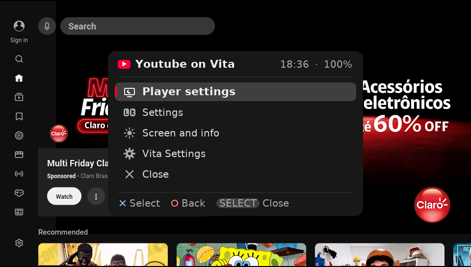
  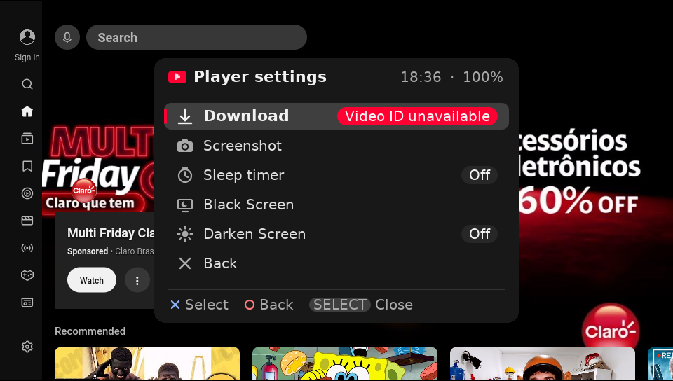
  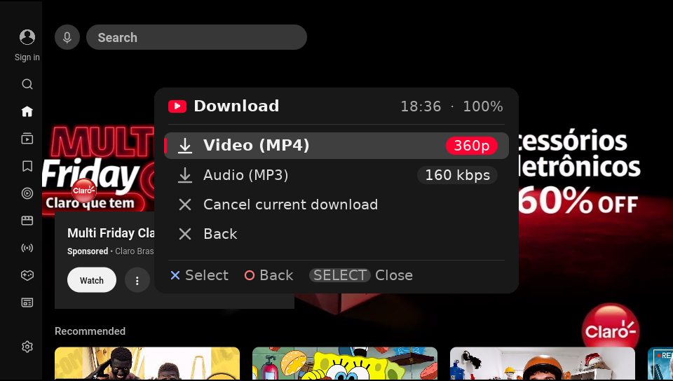
  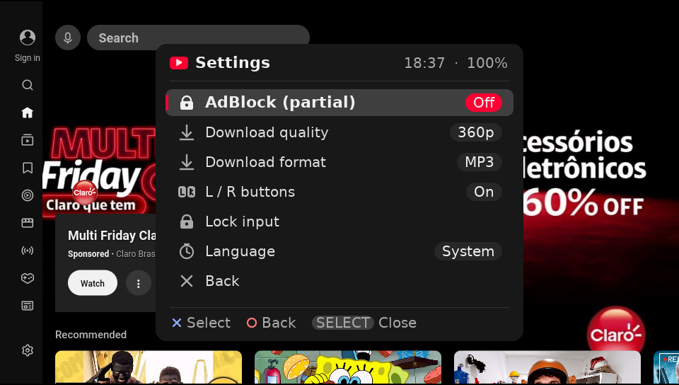
  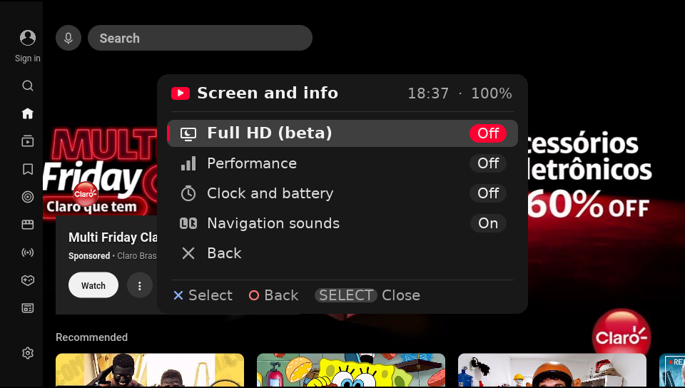

### MP4 and MP3 downloads

Choose **Download → Video (MP4)** or **Audio (MP3)**. MP4 quality depends on stream availability (360p / 480p / 720p). MP3 audio is encoded locally and embeds a **square 1:1 cover image**. Files are saved under <code>ux0:data/youtubevita/downloads/</code>.

Availability depends on each video; playlists, DRM-protected content and some restricted videos are not supported. Only download media you have permission to save.

### AdBlock limitations

**AdBlock is partial.** It filters a small list of known advertising domains at DNS resolution. It cannot reliably remove ads delivered by YouTube itself, including ads streamed from first-party video endpoints. It is not a full YouTube ad blocker.

## Google sign-in and privacy

Google sign-in uses YouTube's own experience inside Cobalt, **not a separate Wolff's Room login server**. Network connections use HTTPS/TLS with certificate verification. Locally persisted account/session data is encrypted and authenticated with **XChaCha20-Poly1305**, using a key derived partly from the console identity.

This improves protection for saved session data but is **not** official Google certification, a hardware secure enclave or a guarantee against every security risk. Use normal care with accounts on modified consoles.

## Screenshots

Real screenshots captured from the running app in **Vita3K**, not interface mockups.

| YouTube on TV | YouTube Music |
| :---: | :---: |
| 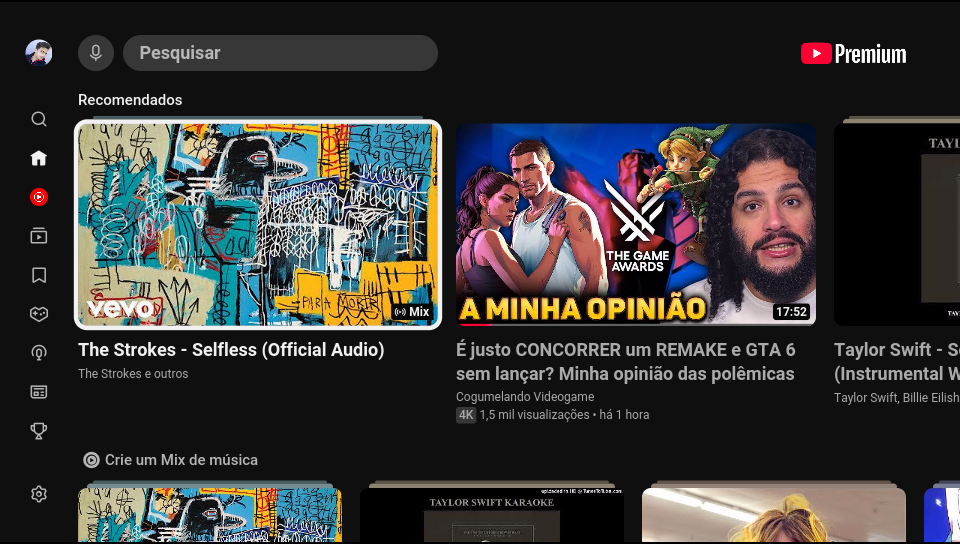 | 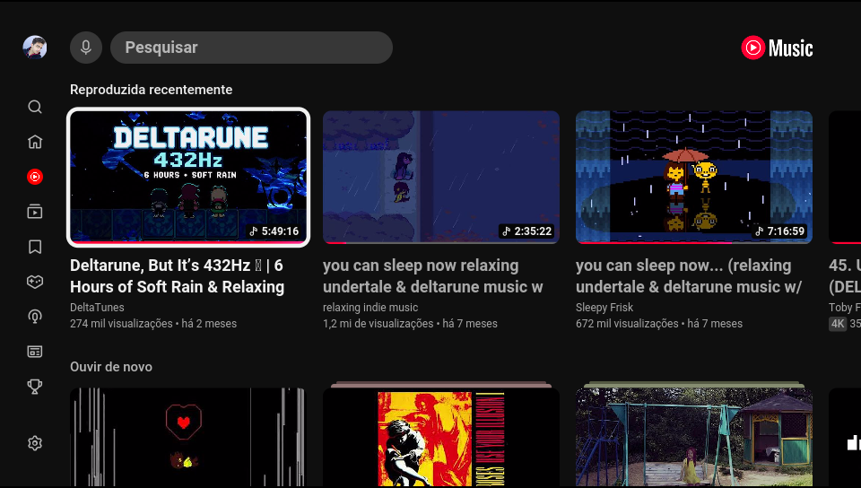 |
| **Search & voice input** | **Native video options** |
| 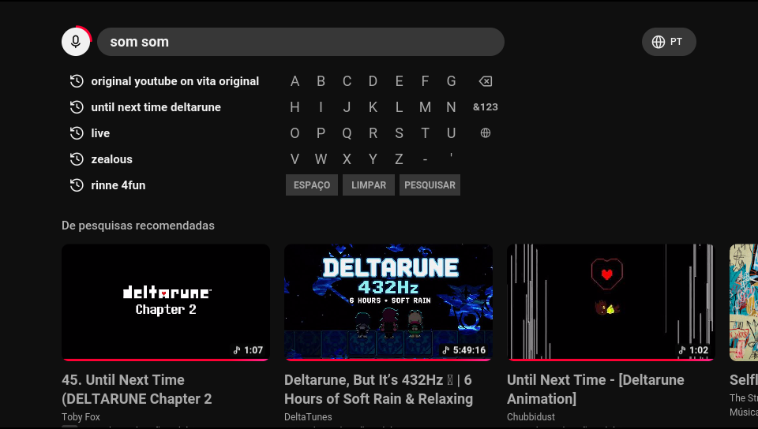 | 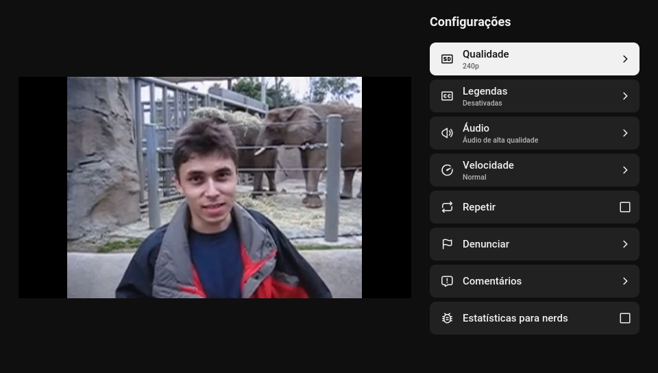 |
| **Captions** | **Playback quality** |
| 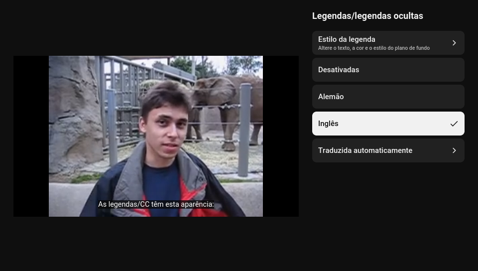 | 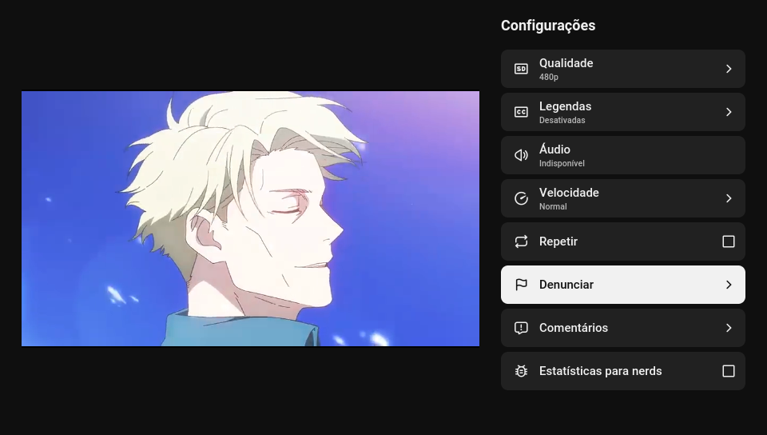 |

More screenshots and native Add-ons views: [assets/prints](assets/prints/).

## Building

This is a **VitaSDK + CMake** project. The provided PowerShell script builds two VPKs using Docker.

1. Clone the repository with submodules: <code>git clone --recursive https://github.com/WolffsRoom/YouTubeOnVita.git</code>.
2. Install Docker and ensure the matching, legally obtained **Cobalt Evergreen/Starboard 15 runtime**, its extracted content, required fonts and dependencies are available in their expected project paths. The upstream browser binary and certain assets are **not included in the source repository**.
3. From the project directory, run **<code>powershell -ExecutionPolicy Bypass -File tools/build_youtube.ps1 -Variant Both</code>**.

The script supports <code>-Variant Normal</code>, <code>-Variant Lite</code> or <code>-Variant Both</code> (default), with <code>-Configuration Release</code> or <code>Debug</code>. It creates <code>current/YouTube.vpk</code> and <code>current/YouTube-Lite.vpk</code>.

| Build | Output | Title ID |
| --- | --- | --- |
| Normal | <code>build-youtube/YouTube.vpk</code> | YTVCB0001 |
| Lite | <code>build-youtube-lite/YouTube-Lite.vpk</code> | YTVCB0002 |

The normal VPK uses extended memory (<code>ATTRIBUTE2=12</code>); the Lite build uses normal memory (<code>ATTRIBUTE2=0</code>). Third-party dependencies and Cobalt assets must comply with their own licenses. Earlier experimental work is archived in [development notes](docs/DEVELOPMENT_NOTES_ARCHIVE.md).

## Credits and visual references

- **[YouTube Brand Resources](https://brand.youtube/)** — visual and identity guidelines.
- **[YouTube Splash Screen Animation by Vikas Raj](https://lottiefiles.com/free-animation/youtube-splash-screen-animation-8wjVJQIQHQ)** — reference for the adapted startup animation (Lottie Simple License).
- **[iOS System Sounds](https://github.com/extratone/iOSSystemSounds/)** — source/reference for optional navigation audio; audio ownership and redistribution rights remain with their respective rights holders.
- **[Google Cobalt](https://github.com/youtube/cobalt)**, [VitaGL](https://github.com/Rinnegatamante/vitaGL), VitaSDK and the Vita homebrew community.

**Unofficial community project.** Not affiliated with, certified or endorsed by Google, YouTube, Sony or Apple. No copyrighted videos or account data are included in this repository.
